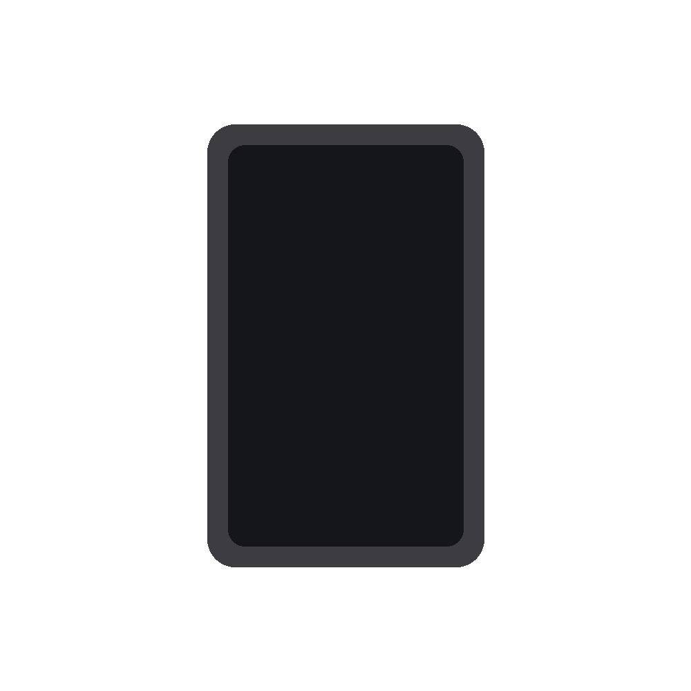
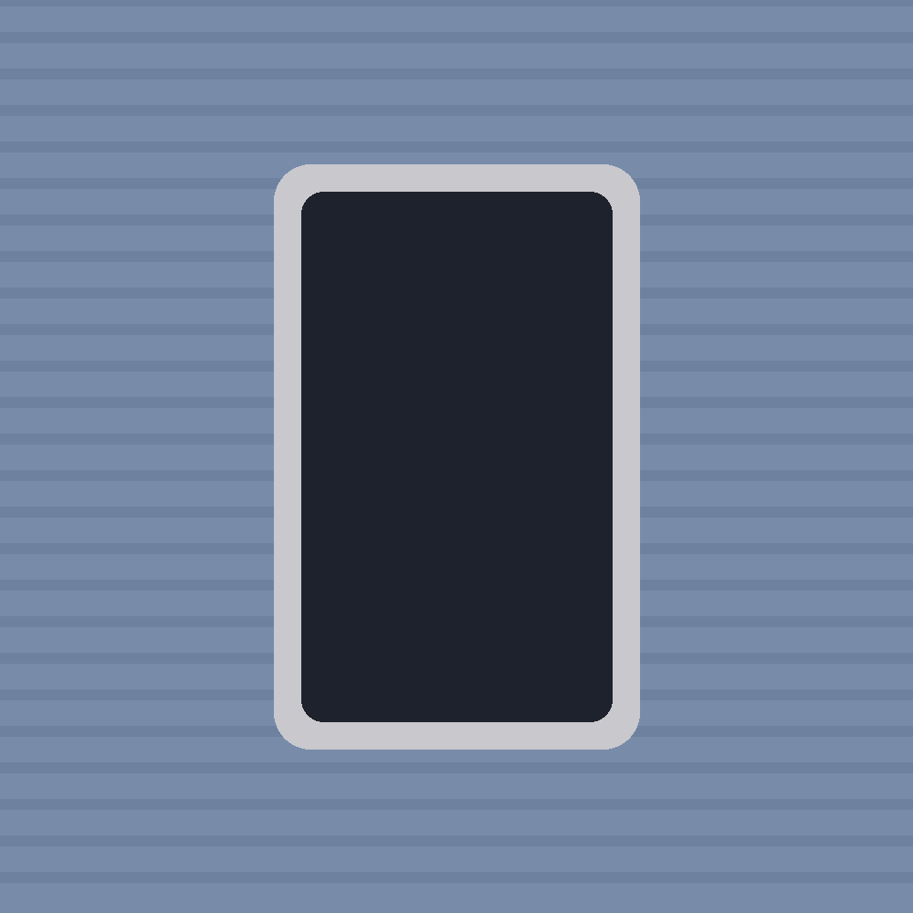
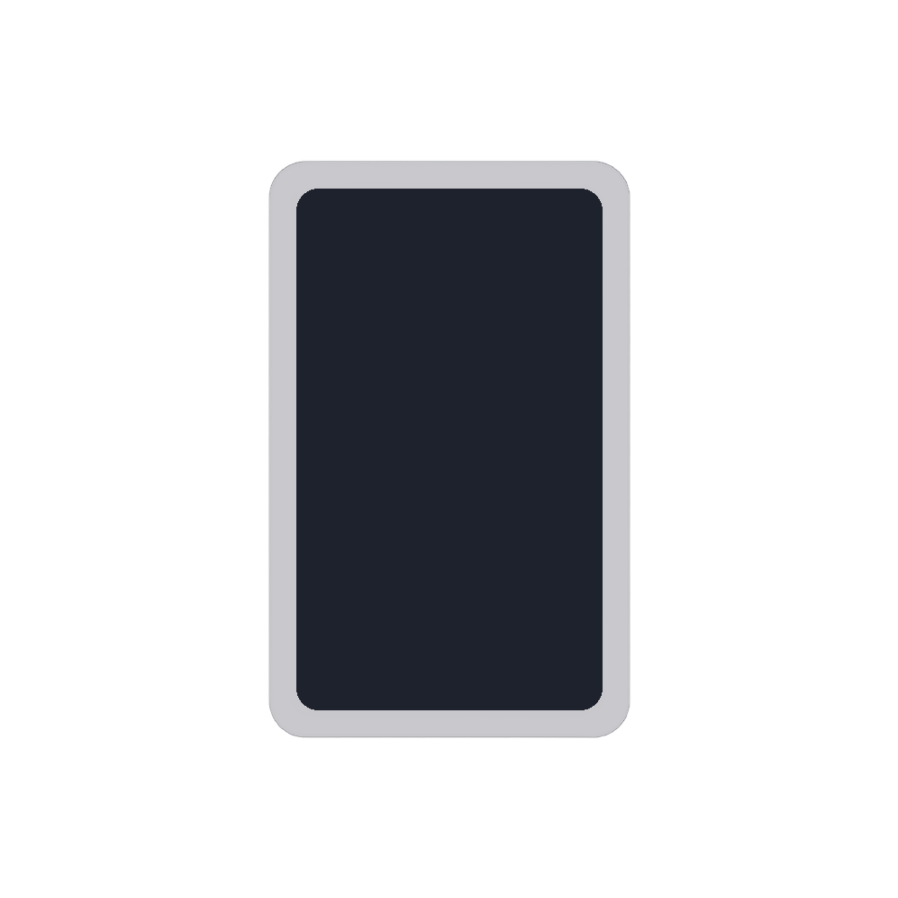
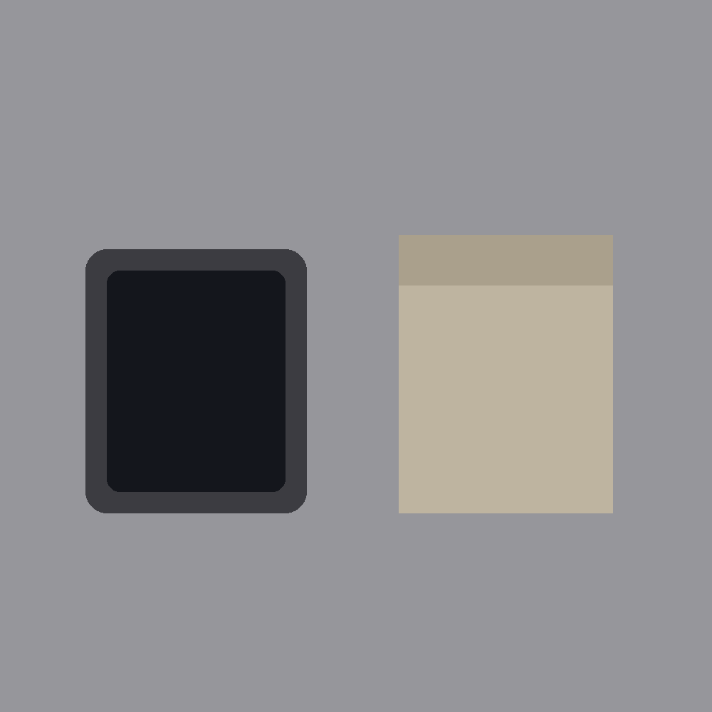

# Examples and failure gallery

All inputs are generated by [`examples/make_samples.py`](../../examples/make_samples.py)
(synthetic, MIT-clean, reproducible). The "after" images are real output of
`remove_background(..., "neural")` (BiRefNet via rembg) on an RTX 4070 Super.

Regenerate inputs yourself:

```bash
python examples/make_samples.py docs/examples/regenerated
```

## 1. Clean background → the planner skips removal

The whole point of `recipe.py`: a clean shot must never go through a neural net,
because it only degrades it and wastes GPU time. Here `recipe.plan` returns
`rembg_mode = "skip"`.

| input | decision |
|---|---|
|  | `skip` (edge whiteness ~1.0) — left untouched |

## 2. Hard but clean background → neural removal works

A textured backdrop with good contrast. `recipe.plan` returns `neural`, and
BiRefNet cuts the device out cleanly onto white.

| input | after (neural) |
|---|---|
|  |  |

## 3. Where it fails: clutter + non-white background

A device next to a second object (a retail box) on a gray backdrop. Off-the-shelf
saliency removal overcuts, the white-threshold fallback cannot clear a non-white
background, and the background survives (white ratio ~0.00). This is exactly the
class of shot where ready-made background removal is not enough yet.

| input | after (neural) — background survived |
|---|---|
|  |  |

Honest note: clean geometric synthetics do not reproduce every real failure
(BiRefNet handles solid dark-on-dark shapes fine). The hard real-world misses are
photographic: dark devices on dark photos, reflective screens, multiple objects.
Solving that post-processing is the subject of a follow-up.
